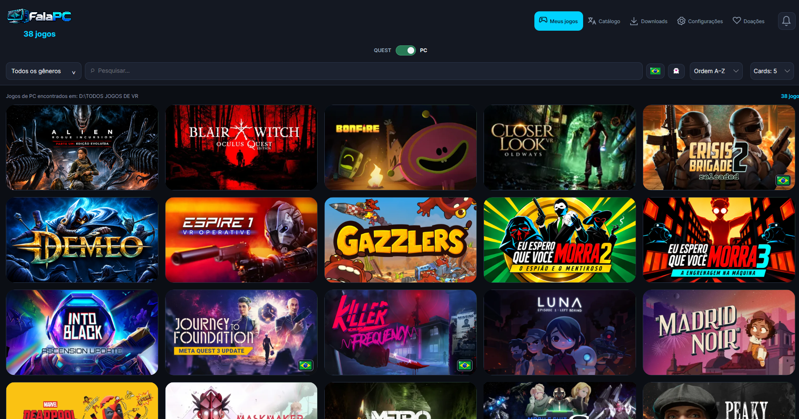

  

  <b>Dublagens e legendas em português para jogos de PC, instaladas com um clique.</b>

  
  

  

> **Este repositório distribui apenas o executável.** O código-fonte do FalaPC não é público. O programa está na aba **[Releases](https://github.com/fabyo/falapc/releases)**.

---

## 💡 Por que o FalaPC existe

O FalaPC surgiu para **facilitar a instalação de dublagens e legendas nos jogos de PC**.

Quem já tentou sabe como costuma ser: baixar um pacote, descobrir a pasta certa do jogo, copiar arquivos na mão, editar configurações e torcer para não quebrar nada, e refazer tudo quando o jogo atualiza. O FalaPC cuida disso por você: confere se o pacote é compatível com a sua versão do jogo, instala e, se você quiser, **volta ao áudio original** com um clique.

É o irmão para PC do **[FalaVR](https://github.com/fabyo/falavr)**, o launcher de traduções para Meta Quest, com a mesma identidade e a mesma ideia: jogar na sua língua, sem dor de cabeça.

---

## ✨ O que ele faz

- 🎙️ **Catálogo de dublagens em português**, com apresentação de cada projeto, **amostras de áudio dos personagens** e **vídeos** mostrando o resultado.
- ⚡ **Instalação com um clique**, sem copiar arquivo manualmente.
- 🛡️ **Instalação segura:** confere o tamanho e o SHA-256 do que foi baixado, valida se o pacote combina com a versão do jogo e só instala com o jogo fechado.
- ↩️ **Restaurar o áudio original** quando quiser. O FalaPC guarda uma cópia do arquivo que ele altera.
- 🔄 **Percebe quando a Steam atualiza o jogo** e a dublagem deixa de ficar ativa, e avisa para reativar.
- 🥽 **Bônus para quem tem Meta Quest:** lista os jogos instalados no headset, instala APKs e OBBs pelo cabo, faz backup de jogos e saves, e ajuda a instalar o FalaVR.
- 🌐 **Capas e informações** dos jogos carregadas automaticamente.

---

## 🎧 Primeira dublagem: Half-Life: Alyx

A primeira dublagem do catálogo é a de **Half-Life: Alyx**, em finalização:

- criada com inteligência artificial e **100% revisada**;
- interpretação com **expressão e emoção**;
- **lipsync** trabalhado: bocas e mandíbulas adaptadas aos fonemas do português brasileiro, com as falas sincronizadas à cena;
- efeitos de voz e ambiência tratados para ficar o mais próximo possível do real;
- **menus e legendas oficiais em português**, para uma imersão total no idioma.

Dublagem feita por **FalaPC (Fabyo)**. Mais jogos virão.

---

## 📥 Como instalar

1. Abra a aba **[Releases](https://github.com/fabyo/falapc/releases/latest)** e baixe o **`FalaPC.exe`**.
2. Coloque o arquivo numa pasta onde você tenha permissão de escrita, por exemplo `Documentos\FalaPC`. Ele é **portátil**: não precisa instalar nada, nem o .NET. Os dados ficam numa pasta `.falapc` ao lado do executável.
3. Dê dois cliques no `FalaPC.exe`.

> ⚠️ **Aviso do Windows:** como o programa é novo e não tem assinatura digital paga, o SmartScreen pode mostrar "O Windows protegeu o computador". Clique em **Mais informações → Executar assim mesmo**. Se quiser conferir que o arquivo é o original, compare o **SHA-256** que aparece nas notas de cada release.

### Requisitos

| | |
|---|---|
| Sistema | Windows 10 ou 11, 64 bits |
| Jogos | O jogo precisa estar instalado no PC (por exemplo, pela Steam) |
| Internet | Necessária para o catálogo, as capas, as amostras e os pacotes |
| Meta Quest (opcional) | Cabo USB de dados e modo desenvolvedor ativado |

---

## 🔒 Privacidade

O FalaPC **só faz requisições de leitura**: baixa catálogo, capas, amostras, vídeos e pacotes. Ele **não envia** a sua biblioteca nem dados pessoais para nenhum servidor.

---

## ⚖️ Avisos

- O FalaPC é um projeto independente e **não é afiliado** a Valve, Meta ou a qualquer estúdio dos jogos citados. Todas as marcas e nomes pertencem aos seus donos.
- O FalaPC **não distribui arquivos originais dos jogos**: você precisa ter o jogo instalado.
- As dublagens e legendas são trabalhos de fãs, criados para quem quer jogar em português.

---

  Feito com carinho por <b>Fabyo</b> · FalaPC · FalaVR

